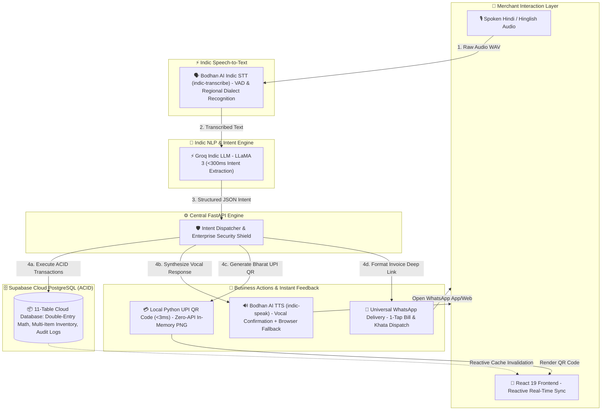

# 🛍️ DukaanAI — Voice-First Indic Retail & Khata Operating System

[](https://opensource.org/licenses/MIT)
[](https://fastapi.tiangolo.com)
[](https://react.dev)
[](https://www.typescriptlang.org)
[](https://supabase.com)
[](https://tailwindcss.com)
[](https://bodhan.ai)
[](https://groq.com)

**DukaanAI** is a production-grade, voice-first intelligent operating system engineered specifically for India's 60M+ retail shopkeepers (*kirana dukandars*). It bridges everyday spoken colloquial Hindi/Hinglish speech with real-time double-entry ledgers, automated multi-item inventory management, instant offline-safe UPI QR code generation, and universal 1-tap WhatsApp billing.

---

## 🎯 The Problem & Hackathon Mission

Over **80% of micro-merchants in India** continue to rely on manual paper notebooks (*bahi khata*) because existing enterprise retail POS software requires tedious typing, complex English interfaces, and expensive desktop hardware.

**DukaanAI** transforms any smartphone or browser into an autonomous retail assistant:
- **Zero Typing Required:** Speak naturally in Hindi or Hinglish — DukaanAI records debits (*udhaar*), credits (*jama*), and inventory updates instantly.
- **Micro-Merchant First:** Instant dynamic UPI QR codes and 1-tap WhatsApp billing eliminate the need for costly soundboxes or thermal receipt printers.
- **Serverless & Ultra-Lightweight:** Decoupled cloud architecture eliminates heavy local AI weights, running smoothly on mobile 4G/5G connections.

---

## 🌟 Architecture & Data Flow



---

## ✨ Core Advanced Features

### 1. 🎙️ Multilingual Indic Speech Pipeline (Hindi, Odia, Tamil, English)
- **Multilingual Speech-to-Text (Bodhan AI `indic-transcribe`):** Real-time Voice Activity Detection (VAD) with dynamic language routing for **Hindi (`hi`)**, **Odia (`or`)**, **Tamil (`ta`)**, and **English (`en`)**. Handles colloquial phrasing, local dialects, and speech recognition noise.
- **Trilingual Financial Intent Extraction (Groq LLaMA-3 <300ms):** Ultra-low latency NLP client parsing natural spoken phrases, inverted syntax, and regional numerals across three major language families:
  - **Hindi (`hi`):** *"रमेश को ₹500 का सामान उधार दे दिया"* &rarr; `action: "record_credit"`, `amount: 500.00`, `customer: "रमेश"`
  - **Odia (`or`):** *"ରମେଶଙ୍କୁ ୫୦୦ ଟଙ୍କା ଉଧାର ଦେଲି / ରମେଶଙ୍କ ଖାତାରେ ୫୦୦ ଟଙ୍କା ଲେଖ"* &rarr; `action: "record_credit"`, `amount: 500.00`, `customer: "ରମେଶ"`
  - **Tamil (`ta`):** *"ரமேஷுக்கு 500 ரூபாய் கடன் கொடு / எழுது"* &rarr; `action: "record_credit"`, `amount: 500.00`, `customer: "ரமேஷ்"`
  - **Payment & Settlement:** *"सुरेश ने ₹200 जमा किए"* / *"ରମେଶ ୨୦୦ ଟଙ୍କା ଜମା କଲେ"* / *"ரமேஷ் 200 ரூபாய் கட்டினார்"*
  - **Spoken Numerals:** Native support for Indian numerals (e.g., Hindi *'हज़ार / सौ'*, Odia *'ଶହେ / ହଜାର'*, Tamil *'நூறு / ஆயிரம்'*).
- **Localized Speech Synthesis (Bodhan AI `indic-speak`):**
  - Synthesizes vocal feedback in the merchant's chosen language with natural phonetics.
  - **Native Currency Localization:** Currency symbols (`₹`) are automatically spoken as `रुपये` in Hindi, `ଟଙ୍କା` (*tanka*) in Odia, and `ரூபாய்` (*roobai*) in Tamil.
  - **Graceful Client Fallback:** If cloud speech encounters network latency, the client automatically falls back to browser-native `window.speechSynthesis` mapped to `hi-IN`, `or-IN`, `ta-IN`, or `en-IN`.
- **Instant Language Switching:** Voice assistant header features 1-tap language pills `[Auto | हिंदी | ଓଡ଼ିଆ | தமிழ் | EN]`, synced with the merchant's cloud store settings and local storage.

### 2. 📦 Multi-Item Voice Inventory Management
- Supports multi-product batch stock adjustments in a single sentence.
- Automatically handles unit extraction (e.g., *kg*, *packet*, *litre*, *piece*), matches existing catalog items or creates new ones, and writes immutable audit entries to `inventory_logs`.

### 3. ⚡ Real-Time Reactive Cache Invalidation
- Voice assistant actions instantly invalidate client-side caching.
- When an item is added or a customer balance is modified via voice, the Khata, Inventory, Customers, and Transactions sections update reactively **without requiring a manual browser refresh**.

### 4. 💳 In-Memory Local UPI QR & Universal WhatsApp
- **Zero External API Blockers:** Generates dynamic Bharat UPI QR codes in-memory via Python `qrcode` + `Pillow` at `GET /api/payments/qr-code?data=...` in **<3ms** (unaffected by CORS blocks or Brave Shields/adblockers).
- **Universal WhatsApp Intent:** Generates compliant WhatsApp deep links (`https://api.whatsapp.com/send?phone=...`) for instant receipt and payment reminder sharing.
- **Strict Compliance:** Merchant details (`shop_name`, `upi_id`) are database-driven; UPI PINs are never stored or requested.

### 5. 📱 Fluid Mobile & Desktop Drawer Physics
- Fluid drawer physics powered by custom cubic-bezier curves (`cubic-bezier(0.16, 1, 0.3, 1)`).
- Collapsible desktop sidebar with perfect icon alignment and zero layout shift.
- Full slide-in touch drawer for customer lists on mobile viewports.

### 6. 🔒 Enterprise Security & Clean Architecture
- **Multi-Tenant Shop Isolation:** Every database query strictly scopes by `shop_id` extracted from cryptographically verified JWT tokens.
- **Sanitized Error Shield:** Intercepts raw database or internal tracebacks, serving friendly messages to users while logging structured JSON with unique correlation IDs (`corr_id`).
- **Serverless & Vercel Native:** Fully decoupled from local PyTorch weights. Startup memory footprint is just **~85MB**, enabling seamless Vercel / Cloud deployment.

### 7. 🗑️ Danger Zone • Safe Account Deletion with Automated Email Ledger
- **Accident-Proof Confirmation:** Located in the Settings portal with a dual-stage safety confirmation (`window.confirm`) to guard against unintended clicks.
- **Pre-Deletion Ledger Harvester:** Queries all shop transactions before deletion, formatting customer names, transaction types (Udhaar `[-]` / Jama `[+]`), amounts, and transaction notes.
- **In-Memory PDF Statement Generator:** Generates a branded ledger statement (`DukaanAI_Final_Ledger_Statement.pdf`) purely in RAM using ReportLab (`io.BytesIO()`) with **zero temporary disk files**, keeping Vercel serverless executions lightning fast and memory-safe.
- **Automated Email Delivery:** Transmits a responsive dark-gold email containing the complete ledger breakdown along with the attached PDF statement to the merchant's registered email address.
- **Atomic Database Cascade Wipe:** Once the statement is safely dispatched, the `DELETE /api/account` endpoint deletes the user record; PostgreSQL `ON DELETE CASCADE` rules instantly and cleanly remove the shop, customers, transactions, inventory, settings, and notifications.

### 8. 📚 Comprehensive In-App Documentation Portal (`/docs`)
- **64+ Interactive Technical Articles:** Built-in 3-column documentation center covering System Architecture, Database Schemas, AI & Voice Engines, API Reference, Security Hardening, and Integrations.
- **1-Click Copyable Code:** Pre-formatted cURL requests, JSON payloads, and response contracts for every backend endpoint.

---

## 🗄️ Database Architecture (Supabase PostgreSQL 15+)

DukaanAI maintains 11 normalized relational tables hosted on **Supabase Cloud PostgreSQL** (`tsymnjjhuedkpzsnsouo`):

| Table | Purpose | Key Attributes & Foreign Keys |
|---|---|---|
| `users` | Merchant authentication & profile | `id`, `name`, `email`, `phone`, `password`, `created_at` |
| `shops` | Multi-tenant store profiles | `id`, `owner_id (FK -> users.id)`, `shop_name`, `address` |
| `customers` | Customer directory & identity | `id`, `shop_id (FK -> shops.id)`, `name`, `phone` |
| `transactions` | Double-entry khata debit/credit ledger | `id`, `shop_id`, `customer_id`, `type`, `amount`, `idempotency_key`, `created_at` |
| `settings` | Dynamic merchant UPI ID & store config | `id`, `shop_id`, `user_id`, `upi_id`, `phone`, `shop_name`, `theme`, `language` |
| `notifications`| Low-stock warnings & payment alerts | `id`, `shop_id`, `title`, `message`, `type`, `is_read`, `created_at` |
| `products` | Product catalog with selling price & units| `id`, `shop_id`, `name`, `price`, `unit` |
| `inventory` | Real-time stock counts & reorder limits | `id`, `shop_id`, `product_id (FK -> products.id)`, `quantity`, `low_stock_limit` |
| `inventory_logs`| Immutable audit log for stock adjustments| `id`, `shop_id`, `product_id`, `quantity_change`, `reason`, `created_at` |
| `suppliers` | Wholesale distributor directory | `id`, `shop_id`, `name`, `category`, `phone`, `created_at` |
| `global_market_prices`| Benchmark Mandi wholesale rates | `id`, `commodity_name`, `price`, `unit`, `updated_at` |

> 📖 **Database Schema Reference:** Complete DDL definitions are available in [`supabase_schema.sql`](supabase_schema.sql) and documented in [`SUPABASE_GUIDE.md`](SUPABASE_GUIDE.md).

---

## 🚀 Quickstart Guide

### 1. Prerequisites
- Python 3.10+
- Node.js 18+ & npm
- Supabase Cloud Project (PostgreSQL)

### 2. Installation
```bash
# Clone the repository
git clone https://github.com/your-username/dukaanai.git
cd dukaanai

# Setup Python virtual environment
python -m venv .venv
.\.venv\Scripts\activate   # On Linux/macOS: source .venv/bin/activate
pip install -r requirements.txt
```

### 3. Environment Configuration (`.env`)
Create a `.env` file in the root directory:
```env
# Supabase Cloud Database Credentials
SUPABASE_URL=https://your-project-id.supabase.co
SUPABASE_KEY=your_supabase_service_role_secret_key

# Security & JWT
SECRET_KEY=your_jwt_signing_secret_here
ENVIRONMENT=production

# Voice AI & LLM Endpoints
GROQ_API_KEY=gsk_your_groq_api_key
BODHAN_AI_STT_API_KEY=your_bodhan_stt_key
BODHAN_AI_STT_URL=https://api.bodhan.ai/v1/audio/transcriptions
BODHAN_AI_TTS_API_KEY=your_bodhan_tts_key
BODHAN_AI_TTS_URL=https://api.bodhan.ai/v1/audio/speech

# Email SMTP (for 2FA OTP & Account Deletion PDF Statements)
EMAIL_ID=your-shop-notifications@gmail.com
EMAIL_APP_PASSWORD=your_gmail_app_password
# Or standard SMTP:
SMTP_HOST=smtp.gmail.com
SMTP_PORT=587
SMTP_USER=your-shop-notifications@gmail.com
SMTP_PASSWORD=your_gmail_app_password
```

### 4. Running the Application
```bash
# Start the FastAPI server (Serves both API and pre-bundled React frontend)
python app.py
```
- **Web App:** [http://127.0.0.1:8000/home](http://127.0.0.1:8000/home)
- **Interactive Documentation:** [http://127.0.0.1:8000/docs](http://127.0.0.1:8000/docs)
- **FastAPI OpenAPI Swagger:** [http://127.0.0.1:8000/api/docs](http://127.0.0.1:8000/api/docs)
- **Landing Showcase:** [http://127.0.0.1:8000/landing](http://127.0.0.1:8000/landing)

---

## 🧪 Testing

Run the automated test suite verifying security, authentication, multi-tenant isolation, and intent handling:
```bash
python -m unittest discover tests
```

---

## 📄 License

This project is licensed under the **MIT License** — see the [LICENSE](LICENSE) file for details.
